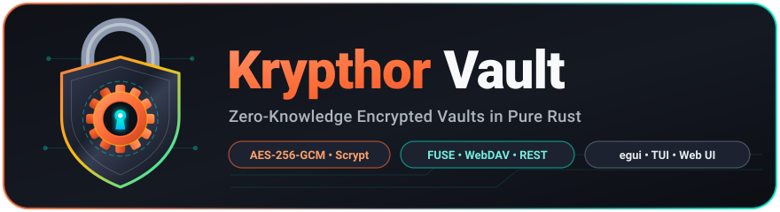

# 🔐 Krypthor Vault (Rust & egui / Ratatui / Web Daemon)



[](LICENSE)
[](https://www.rust-lang.org/)
[]()

**Krypthor Vault** (`krypthor`) ist eine moderne, speichersichere und performante Zero-Knowledge-Tresor-Lösung in Pure Rust mit einer Desktop-Oberfläche auf Basis von `egui` und `egui-elegance`, einem Terminal-Interface (TUI via `ratatui`), einem **Syncthing-ähnlichen Web-Dashboard / Hintergrund-Daemon** sowie einer vollständigen Befehlszeilenschnittstelle (CLI) inklusive FUSE- und WebDAV-Dateisystemintegration.

## Features

- **Erstellung neuer Tresore**: Generiert ein kryptografisches Salz, leitet einen Schlüssel mittels `Scrypt` ab und verschlüsselt den Masterkey via `AES-256-GCM`.
- **Tresor-Verwaltung**: Speichert registrierte Tresore persistent in `vaults.json`.
- **Desktop-Dateimanager**: Ermöglicht das Anlegen, Importieren, Exportieren und Löschen von verschlüsselten Dateien und Verzeichnissen direkt über die grafische Oberfläche (`egui`).
- **Web-Dashboard & Headless Daemon (Syncthing-Stil)**:
  - Integrierter Pure-Rust Webserver via `axum` und `tokio`.
  - **Single-Binary**: Vollwertiges, responsives HTML5/CSS3/JS Single-Page-Dashboard direkt in die Binary einkompiliert (`src/web/index.html`).
  - Funktioniert im Browser auf Desktop, Tablet und Smartphone (Drag & Drop Upload, Download, Entsperren, Sperren, Textdateien erstellen).
  - **In-App Text-Editor**: Text- und Markdown-Dateien können direkt im Web-Interface betrachtet und bearbeitet werden.
  - **Live-Dateisuche & Tresorstatistiken**: Sofortige Volltextsuche über alle Ordner hinweg sowie Anzeige von Dateianzahl und belegtem Speicherplatz.
  - **Passwortänderung & Wiederherstellungsschlüssel**: Bequeme Passwortaktualisierung im laufenden Betrieb sowie Export und Entsperrung via 64-stelligem Recovery-Key.
  - **ZIP-Direktexport**: Entschlüsselter Komplett-Download des Tresors oder einzelner Unterordner als ZIP-Archiv direkt im Browser oder per REST-API (`/api/vaults/export_zip?path=...&subfolder=...`).
  - **Konfigurierbares Auto-Lock**: Automatische Sperrung und sichere Speicherbereinigung entsperrter Tresore bei Inaktivität (wählbar: 5, 15, 30, 60 Minuten oder deaktiviert) mit Status-Badge.
  - REST-API für Automatisierung (`/api/vaults`, `/api/vaults/rename_vault`, `/api/vaults/unlock`, `/api/vaults/recover`, `/api/vaults/files`, `/api/vaults/find`, `/api/vaults/stats`, `/api/vaults/export_zip`, `/api/vaults/change_password`, `/api/vaults/recovery_key`, `/api/vaults/backup_key`, `/api/vaults/restore_key`, `/api/vaults/copy`, `/api/vaults/hash`, `/api/vaults/prune`, `/api/system/benchmark`, `/api/system/doctor`, etc.).
- **Terminal User Interface (TUI)**: Volles TUI-Interface basierend auf `ratatui` und `crossterm` zur Verwaltung und Navigation im Terminal inklusive Inaktivitäts-Auto-Lock.
- **FUSE Dateisystem-Integration**: Erlaubt unter Linux/Unix das Einbinden des verschlüsselten Tresors direkt als virtuelles Verzeichnis im Dateisystem via Pure-Rust FUSE (ohne C `libfuse`-Bindung).
- **Streaming I/O**: Direkte Stream-Verarbeitung (Reader/Writer) für `put`, `cat`, `import` und `export` zur Minimierung der RAM-Auslastung bei großen Datenmengen.
- **Transparente Zstd-Kompression & Versionierter Payload-Header**:
  - Jede verschlüsselte Datei enthält einen festen 24-Byte-Header (`b"KRYP"` Magic, Versionierung `v1`, Kompressions-Flag).
  - Standardmäßig werden Text- und Datendateien vor der AES-256-GCM-Verschlüsselung transparent mit **`zstd`** komprimiert.
  - Bereits komprimierte Formate (`.jpg`, `.zip`, `.mp4`, `.pdf` etc.) werden automatisch erkannt und ohne Kompressionsmehraufwand gespeichert.
  - Pro Datei und Import feingranular steuerbar (`--compression auto|always|never`).
  - Transparenter Abwärtskompatibilitäts-Fallback auf unversionierte v0-Payloads.
- **Katastrophenschutz & Resilienz**: Atomare Schreibvorgänge via PID-Temporärdateien (`fs::rename`) sowie automatische Pflege von `masterkey.json.bkup` mit transparentem Fallback-Entsperren.
- **CLI-Befehle**: Vollwertige Steuerung ohne GUI über 22 Subcommands (`create`, `mount`, `ls`, `find`, `put`, `cat`, `rm`, `cp`, `mv`, `stats`, `mkdir`, `export`, `import`, `verify`, `backup-key`, `restore-key`, `benchmark`, `doctor`, `hash`, `prune`, `tui`, `serve`).
- **Sicherheitsarchitektur**:
  - **Schlüsselableitung**: Scrypt (N=16384, r=8, p=1) mit optionaler Unterstützung für Schlüsseldateien (Keyfiles).
  - **Dateiverschlüsselung**: Authenticated Encryption mit AES-256-GCM. Jede Datei enthält einen zufälligen 12-Byte-Nonce und verschlüsselte Pfadmetadaten.
  - **Dateinamen-Verschleierung**: Physikalische Dateinamen auf dem Datenträger werden deterministisch durch `SHA-256(master_key || relativer_pfad)` verschleiert.
  - **Auto-Lock**: Automatische Sperrung des entsperrten Tresors bei Inaktivität nach konfigurierbarer Zeit.
- **Code-Qualität & Modularität**:
  - Modularer Feature-Aufbau: FUSE ist als optionales Feature (`--features fuse`) entkoppelt; der Standard-Build ist 100 % portabel und benötigt weder Root-/Sudo-Rechte noch FUSE-Kernel-Treiber.
  - Strikte Zero-Panic-Policy via Clippy (`panic`, `unwrap_used`, `expect_used`, `panic_in_result_fn`, `unreachable`, `todo`, `unimplemented` auf `deny`).
  - Lizenzprüfung via [`deny.toml`](deny.toml) und automatisierter Integrationstest [`tests/test_license_compatibility.rs`](tests/test_license_compatibility.rs) zur Sicherstellung der MIT-Kompatibilität aller Abhängigkeiten.
  - Plattformübergreifend lauffähig (Linux X11/Wayland, macOS, Windows).

## Voraussetzungen & Installation

### Voraussetzungen (Linux)
Da die FUSE-Treiber-Implementierung 100 % in Pure Rust läuft, wird **keine C-Entwicklungsbibliothek (`libfuse3-dev`) zum Kompilieren benötigt**. Für unprivilegierte Desktop-Mounts und die GUI werden lediglich Grafikbibliotheken und das Systemwerkzeug `fuse3` (`fusermount3`) benötigt:

```bash
# Debian / Ubuntu
sudo apt install fuse3 pkg-config libx11-dev libxcursor-dev libxrandr-dev libxi-dev libgl1-mesa-dev

# Fedora
sudo dnf install fuse3 pkgconf-pkg-config libX11-devel libXcursor-devel libXrandr-devel libXi-devel mesa-libGL-devel

# Arch Linux
sudo pacman -S fuse3 pkgconf libx11 libxcursor libxrandr libxi mesa
```

### 1-Klick Installation (Syncthing-Stil)

Krypthor Vault bietet automatisierte Installations-Skripte für alle drei großen Plattformen, die das Release-Binary kompilieren, Desktop-Starter/Icons einrichten und einen **Hintergrund-Daemon im Syncthing-Stil** (Auto-Start bei Login, Web-Dashboard auf Port 8080) konfigurieren:

#### Linux (`systemd --user` + Desktop-Starter)
```bash
./scripts/install-linux.sh

# Zur sauberen Deinstallation:
./scripts/install-linux.sh --uninstall
```

#### macOS (`launchd` LaunchAgent + Web App)
```bash
./scripts/install-macos.sh

# Zur sauberen Deinstallation:
./scripts/install-macos.sh --uninstall
```

#### Windows (Scheduled Task + Startmenü / Desktop-Shortcuts)
```powershell
powershell -ExecutionPolicy Bypass -File .\scripts\install-windows.ps1

# Zur sauberen Deinstallation:
powershell -ExecutionPolicy Bypass -File .\scripts\install-windows.ps1 -Uninstall
```

### Manuelles Bauen

```bash
# Standard-Build (Portabel, ohne FUSE-Abhängigkeit)
cargo build --release

# Mit FUSE-Dateisystemunterstützung (Linux/Unix)
cargo build --release --features fuse
```

## Verwendung

### 1. Grafische Oberfläche (GUI)
Standardmäßig startet `krypthor` im Desktop-GUI-Modus:
```bash
cargo run --release
```

### 2. Terminal User Interface (TUI)
Für die intuitive Bedienung im Terminal:
```bash
cargo run --release -- tui
# Alternativ:
cargo run --release -- --tui
```
- `[↑/↓]` oder `[j/k]`: Tresor auswählen
- `[Enter]` oder `[u]`: Tresor mit Passwort & optionaler Schlüsseldatei entsperren & FUSE-Mount aktivieren
- `[v]`: Kryptografische Integritätsprüfung für entsperrten Tresor ausführen
- `[b]`: Masterkey-Sicherheitskopie für ausgewählten Tresor anlegen
- `[n]`: Ausgewählten Tresor umbenennen
- `[d]`: Ausgewählten Tresor aus der Liste entfernen
- `[r]`: Tresor mit 64-stelligem Recovery-Key wiederherstellen & mounten
- `[x]`: Wiederherstellungsschlüssel des entsperrten Tresors anzeigen
- `[l]`: Tresor sperren & unmounten
- `[a]`: Bestehenden Tresorpfad registrieren
- `[c]`: Neuen Tresor interaktiv erstellen (4-stufiger Assistent inkl. optionaler 2FA-Schlüsseldatei)
- `[q]`: TUI beenden

### 3. Web-Client & Daemon (Syncthing-Stil)
Startet den Hintergrunddienst mit eingebettetem Web-Dashboard:
```bash
cargo run --release -- serve --host 127.0.0.1 --port 8080
# Alternativ:
cargo run --release -- --serve
```
Anschließend im Browser **`http://127.0.0.1:8080`** aufrufen, um Tresore zu verwalten, zu entsperren und Dateien per Drag & Drop zu übertragen.

### 4. CLI-Befehle
Die Anwendung kann auch direkt per Befehlszeile gesteuert werden. Alle Befehle, die einen Tresor erstellen, entsperren oder ändern, unterstützen optional das `--keyfile <PFAD>` Flag für Zwei-Faktor-Schutz:

#### Tresore auflisten
```bash
cargo run --release -- list
```

#### Bestehenden Tresor registrieren (add)
```bash
cargo run --release -- add --path "/pfad/zum/tresor" --name "MeinTresor"
```

#### Tresor aus Registrierung entfernen (remove)
```bash
cargo run --release -- remove --path "/pfad/zum/tresor"
```

#### Registrierten Tresor umbenennen (rename-vault)
```bash
cargo run --release -- rename-vault --path "/pfad/zum/tresor" --new-name "NeuerTresorName"
```

#### Neuen Tresor anlegen
```bash
cargo run --release -- create --name "MeinTresor" --path "/pfad/zum/tresor"
# Optional mit Passwort (wenn weggelassen, erfolgt eine interaktive Eingabeaufforderung):
cargo run --release -- create --name "MeinTresor" --path "/pfad/zum/tresor" --password "geheim"
```

#### Tresor als WebDAV-Netzlaufwerk bereitstellen (Standard-Build, plattformunabhängig)
Startet einen lokalen WebDAV-Endpunkt zur nativen Einbindung im Betriebssystem ohne Kernel-Treiber oder Administrator-/Root-Rechte:
```bash
cargo run --release -- webdav --path "/pfad/zum/tresor"
# Mit spezifischem Port und Passwort:
cargo run --release -- webdav --path "/pfad/zum/tresor" --port 8081 --password "geheim"
```

**Betriebssystem-Anbindung (WebDAV):**
* **Windows (Explorer):** *Netzlaufwerk verbinden* ➔ Adresse: `http://localhost:8081/`
* **macOS (Finder):** *Gehe zu* ➔ *Mit Server verbinden* (`⌘K`) ➔ `http://localhost:8081/`
* **Linux (GNOME Files / Dolphin):** *Mit Server verbinden* ➔ `dav://localhost:8081/`

*Hinweis: Wenn der Web-Daemon (`cargo run --release -- serve`) läuft, sind alle dort entsperrten Tresore automatisch auch über `http://localhost:8080/webdav/<TresorName>/` im Dateimanager erreichbar.*

#### Tresor mounten (FUSE, erfordert `--features fuse`)
```bash
cargo run --release --features fuse -- mount --path "/pfad/zum/tresor" --mountpoint "/pfad/zum/mountpunkt"
# Optional mit Passwort:
cargo run --release --features fuse -- mount --path "/pfad/zum/tresor" --mountpoint "/pfad/zum/mountpunkt" --password "geheim"
```

Zum Aushängen des FUSE-Verzeichnisses:
```bash
cargo run --release --features fuse -- unmount --mountpoint "/pfad/zum/mountpunkt"
# Oder via fusermount:
fusermount -u "/pfad/zum/mountpunkt"
```

#### Passwort ändern
```bash
cargo run --release -- change-password --path "/pfad/zum/tresor"
# Oder mit Parametern:
cargo run --release -- change-password --path "/pfad/zum/tresor" --old-password "altes_pw" --new-password "neues_pw"
```

#### Wiederherstellungsschlüssel exportieren
```bash
cargo run --release -- recovery-key --path "/pfad/zum/tresor"
```

#### Tresor mit Wiederherstellungsschlüssel prüfen / entsperren
```bash
cargo run --release -- recover --path "/pfad/zum/tresor" --key "XXXX-XXXX-XXXX-..."
```

#### Dateien im Tresor auflisten (ls)
```bash
cargo run --release -- ls --path "/pfad/zum/tresor"
# Mit Dateigröße und Änderungsdatum (-l / --long):
cargo run --release -- ls --path "/pfad/zum/tresor" -l
# Mit Filterung nach Begriff:
cargo run --release -- ls --path "/pfad/zum/tresor" --pattern "dokumente"
```

#### Dateien suchen (find)
Sucht gezielt nach Dateien anhand eines Suchbegriffs (optional mit detaillierter Ansicht `-l`):
```bash
cargo run --release -- find --path "/pfad/zum/tresor" -q "bericht"
# Mit Detailansicht:
cargo run --release -- find --path "/pfad/zum/tresor" -q "bericht" -l
```

#### Datei in Tresor verschlüsseln & ablegen (put)
Standardmäßig wird intelligentes `auto`-Komprimieren mit Zstd angewandt (komprimiert Text/JSON/Code, überspringt inkomprimierbare Formate wie JPG, ZIP, MP4):
```bash
cargo run --release -- put --path "/pfad/zum/tresor" --source "lokale_datei.txt" --target "ordner/datei.txt"

# Komprimierung explizit steuern (--compression auto|always|never):
cargo run --release -- put --path "/pfad/zum/tresor" --source "backup.raw" --target "ordner/backup.raw" --compression always
cargo run --release -- put --path "/pfad/zum/tresor" --source "daten.bin" --target "ordner/daten.bin" --compression never
```

#### Dateiinhalt entschlüsseln & ausgeben (cat)
```bash
cargo run --release -- cat --path "/pfad/zum/tresor" --file "ordner/datei.txt"
```

#### Datei oder Ordner im Tresor löschen (rm)
Standardmäßig werden gelöschte Dateien und Ordner in den tresorinternen Papierkorb (`.trash/`) verschoben und können wiederhergestellt werden. Mit dem Flag `--permanent` werden sie sofort unwiderruflich physikalisch gelöscht:
```bash
# In den Papierkorb verschieben:
cargo run --release -- rm --path "/pfad/zum/tresor" --file "ordner/datei.txt"

# Verzeichnis rekursiv in den Papierkorb verschieben (-r / --recursive):
cargo run --release -- rm --path "/pfad/zum/tresor" --file "ordner" -r

# Sofort endgültig löschen ohne Papierkorb (--permanent):
cargo run --release -- rm --path "/pfad/zum/tresor" --file "ordner/datei.txt" --permanent
```

#### Papierkorb verwalten (trash)
Verwaltet den tresorinternen Papierkorb für versehentlich gelöschte Dateien:
```bash
# Alle Dateien im Papierkorb auflisten (optional mit --json):
cargo run --release -- trash list --path "/pfad/zum/tresor"
cargo run --release -- trash list --path "/pfad/zum/tresor" --json

# Datei oder Verzeichnis aus dem Papierkorb wiederherstellen:
cargo run --release -- trash restore --path "/pfad/zum/tresor" -t ".trash/1729780000##ordner/datei.txt"

# Papierkorb vollständig und unwiderruflich leeren:
cargo run --release -- trash empty --path "/pfad/zum/tresor"

# Dateien im Papierkorb bereinigen, die älter als N Tage sind (Retention Policy):
cargo run --release -- trash prune --path "/pfad/zum/tresor" --days 30
cargo run --release -- trash prune --path "/pfad/zum/tresor" --days 30 --json
```

#### JSON-Ausgabe für Scripting & CI/CD (--json)
Alle lesenden Befehle (`list`, `ls`, `find`, `stats`, `verify`, `recovery-key`) unterstützen das `--json` Flag für maschinenlesbare JSON-Ausgaben:
```bash
cargo run --release -- ls --path "/pfad/zum/tresor" --json
cargo run --release -- stats --path "/pfad/zum/tresor" --json
cargo run --release -- verify --path "/pfad/zum/tresor" --json
```

#### Datei oder Ordner im Tresor verschieben / umbenennen (mv)
```bash
cargo run --release -- mv --path "/pfad/zum/tresor" --old-path "dokumente/alt.txt" --new-path "archiv/neu.txt"
```

#### Datei oder Ordner im Tresor kopieren (cp)
Kopiert Dateien oder rekursiv ganze Verzeichnisbäume innerhalb des Tresors ohne Entschlüsselung auf das Dateisystem:
```bash
# Einzelne Datei duplizieren
cargo run --release -- cp --path "/pfad/zum/tresor" --src "dokumente/rechnung.pdf" --dst "dokumente/rechnung_kopie.pdf"

# Ganzes Verzeichnis rekursiv kopieren (-r)
cargo run --release -- cp --path "/pfad/zum/tresor" --src "projekte/alpha" --dst "archiv/alpha_backup" -r
```

#### Tresor-Statistiken abrufen (stats)
```bash
cargo run --release -- stats --path "/pfad/zum/tresor"
```

#### Verzeichnis im Tresor erstellen (mkdir)
```bash
cargo run --release -- mkdir --path "/pfad/zum/tresor" --folder "projekte/geheim"
```

#### Tresor oder Unterordner in lokales Verzeichnis exportieren (export)
```bash
# Gesamten Tresor exportieren
cargo run --release -- export --path "/pfad/zum/tresor" --dest "/pfad/zum/zielordner"

# Nur einen bestimmten Unterordner exportieren
cargo run --release -- export --path "/pfad/zum/tresor" --dest "/pfad/zum/zielordner" --subfolder "dokumente/projekte"
```

#### Lokales Verzeichnis rekursiv in den Tresor importieren (import)
```bash
cargo run --release -- import --path "/pfad/zum/tresor" --source "/pfad/zur/quelle" --dest "backup"

# Optional mit Kompressions-Modus (--compression auto|always|never):
cargo run --release -- import --path "/pfad/zum/tresor" --source "/pfad/zur/quelle" --dest "backup" --compression auto
```

#### Kryptografische Tresor-Integritätsprüfung (verify)
Überprüft sämtliche verschlüsselte Dateien im Tresor anhand ihrer AES-256-GCM Authentifizierungs-Tags auf Bitfehler, Manipulation oder verwaiste Dateien:
```bash
cargo run --release -- verify --path "/pfad/zum/tresor"
```

#### Masterkey sichern (backup-key)
Erstellt eine explizite, zeitgestempelte oder benutzerdefinierte Sicherheitskopie der `masterkey.json`:
```bash
cargo run --release -- backup-key --path "/pfad/zum/tresor"
# Oder mit Zielpfad:
cargo run --release -- backup-key --path "/pfad/zum/tresor" --out "/backup/tresor_key.json"
```

#### Masterkey wiederherstellen (restore-key)
Stellt die `masterkey.json` aus der automatischen `masterkey.json.bkup` oder einer angegebenen Sicherungskopie atomar wieder her:
```bash
cargo run --release -- restore-key --path "/pfad/zum/tresor"
# Oder aus bestimmter Datei:
cargo run --release -- restore-key --path "/pfad/zum/tresor" --from "/backup/tresor_key.json"
```

#### Kryptografischen Performance-Benchmark ausführen (benchmark)
Misst den realen Durchsatz der kryptografischen Primitive (Scrypt KDF, AES-256-GCM Ver-/Entschlüsselung in MB/s und SHA-256 Pfad-Obfuskation):
```bash
cargo run --release -- benchmark
# Maschinenlesbare Ausgabe als JSON:
cargo run --release -- benchmark --json
```

#### Systemumgebung und Tresor-Gesundheit prüfen (doctor)
Prüft das Dateisystem, FUSE-Rechte (`/dev/fuse`), CSPRNG-Zufallsgeneratoren sowie die Integrität aller registrierten Tresore:
```bash
cargo run --release -- doctor
# Maschinenlesbare Ausgabe als JSON:
cargo run --release -- doctor --json
```

#### SHA-256 Prüfsumme einer Datei im Tresor berechnen (hash)
Berechnet den SHA-256 Hash direkt aus dem verschlüsselten Tresor im Streaming-Verfahren, ohne die Datei auf die Festplatte zu entschlüsseln:
```bash
cargo run --release -- hash --path "/pfad/zum/tresor" --file "dokumente/rechnung.pdf"
# Maschinenlesbare Ausgabe als JSON:
cargo run --release -- hash --path "/pfad/zum/tresor" --file "dokumente/rechnung.pdf" --json
```

#### Verwaiste und temporäre Fragmente bereinigen (prune)
Entfernt unvollständige Upload-Fragmente (`.tmp`) und verwaiste Dateien aus dem Speicherverzeichnis `d/`:
```bash
# Vorschau ohne Löschung (--dry-run)
cargo run --release -- prune --path "/pfad/zum/tresor" --dry-run

# Tatsächliche Bereinigung
cargo run --release -- prune --path "/pfad/zum/tresor"
```

## Projektstruktur

- [`src/lib.rs`](src/lib.rs): Crate-Bibliotheks-Wurzel für Modul- und Integrationsanbindung.
- [`src/main.rs`](src/main.rs): Einstiegspunkt, CLI-Argument-Parsing (`clap`) und Befehls-Dispatching.
- [`src/vault.rs`](src/vault.rs): Kryptografischer Kern (Scrypt KDF, AES-256-GCM, Pfad-Hashing, Tresor-Initialisierung & Dateiverschlüsselung).
- [`src/webdav_fs.rs`](src/webdav_fs.rs): Plattformunabhängige WebDAV-Dateisystem-Implementierung (`dav-server`) für native Netzlaufwerk-Einbindung.
- [`src/web_server.rs`](src/web_server.rs): Web-Server und REST-API via `axum` und `tokio`.
- [`src/web/index.html`](src/web/index.html): Eingebettetes, responsives Web-Dashboard (Single-Page-App).
- [`src/egui_ui.rs`](src/egui_ui.rs): Desktop-GUI basierend auf `eframe`, `egui` und `egui-elegance`.
- [`src/fs_fuse.rs`](src/fs_fuse.rs): Virtuelles FUSE-Dateisystem (Unix/Linux, optional via `--features fuse`).
- [`src/tui_app.rs`](src/tui_app.rs): Terminal-Benutzeroberfläche basierend auf `ratatui` und `crossterm`.
- [`tests/test_webdav.rs`](tests/test_webdav.rs): Integrations- und Routing-Tests für den WebDAV-Server.
- [`tests/test_license_compatibility.rs`](tests/test_license_compatibility.rs): Automatisierter Test zur Verifikation der MIT-Lizenzkompatibilität des Crate-Baums.
- [`deny.toml`](deny.toml): Konfiguration für `cargo-deny`.

## Tests & Code-Qualität

```bash
# Tests ausführen
cargo test

# Clippy Linter
cargo clippy

# Formatierung prüfen
cargo fmt -- --check
```

## Lizenz

Dieses Projekt ist unter der MIT-Lizenz lizenziert.
